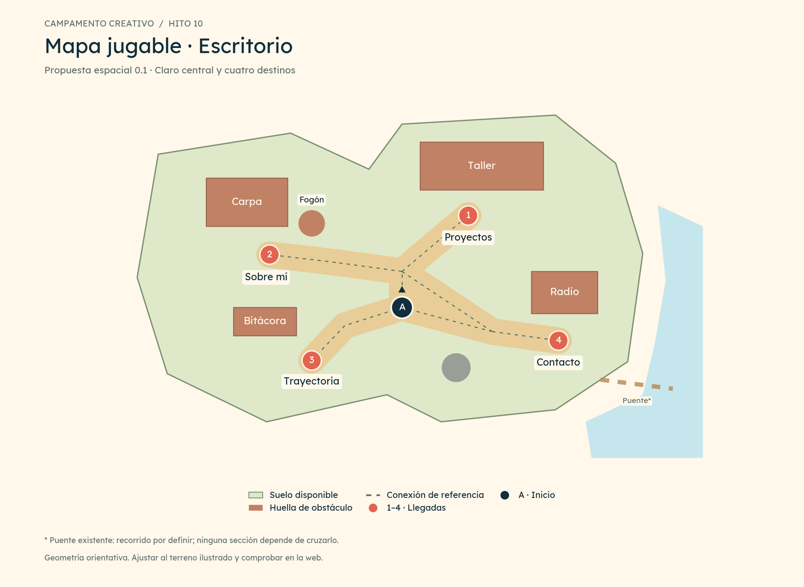
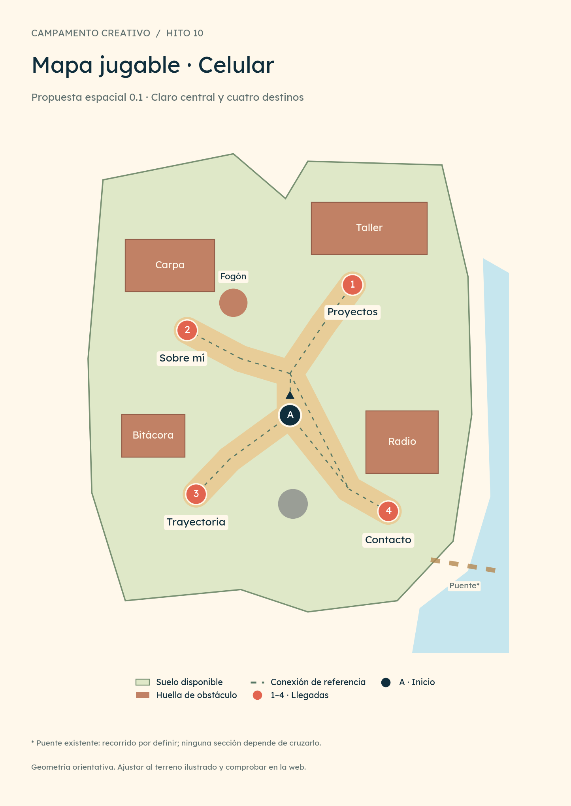

# 10 · Hito de mapa jugable

**Proyecto:** Portfolio de Alejo Palavecino · Campamento creativo  
**Versión:** 0.3 · **Fecha:** 29 de octubre de 2026 · **Fase:** P4  
**Estado:** distribución base adoptada por Alejo mediante DEC-28; geometría orientativa e integración pendientes de ajuste y comprobación.

## 1. Qué define este hito

Concretar dónde empieza el personaje, por dónde puede caminar y dónde se detiene para abrir cada sección. El mapa base adoptado utiliza un **claro central con cuatro ramales cortos**, siguiendo las relaciones espaciales de las maquetas adoptadas.

Alejo eligió en DEC-26 la caminata manual y la selección de una sección con recorrido automático y apertura al llegar. Su pedido de avanzar a este hito se registra como DEC-27. Después de revisar los planos, Alejo confirmó que esta distribución le cierra como mapa base; DEC-28 registra esa adopción. Se confirma el claro central, el personaje en el centro, el protagonismo del taller y la ubicación relativa de los cuatro destinos. Las medidas, huellas y controles de detalle conservan su carácter de referencia para integración.

La ficha integrada, el emblema, la cabecera móvil y el contenido profesional conservan sus decisiones y pendientes. [09 · Experiencia e interacciones](09_HITO_EXPERIENCIA_E_INTERACCIONES.md) mantiene las reglas de navegación; este documento especifica su organización espacial.

## 2. La distribución base adoptada

El personaje aparece en reposo en el claro central, con orientación inicial hacia la zona del taller. Desde allí se reconocen los cuatro destinos. El taller conserva mayor presencia visual por su relación con el trabajo que interesa mostrar.

| Número del plano | Lugar | Sección | Ubicación y llegada |
|---|---|---|---|
| 1 | Taller | Proyectos | Arriba y a la derecha. Llegada delante de la entrada, sobre tierra y fuera de la huella del edificio. |
| 2 | Carpa y fogón | Sobre mí | A la izquierda. Llegada en un espacio libre junto al frente de la carpa, alejado del fuego. |
| 3 | Mesa de bitácora | Trayectoria | Abajo y a la izquierda. Llegada junto al lado accesible de la mesa. |
| 4 | Puesto de radio | Contacto | Abajo y a la derecha. Llegada desde el claro derecho, en el mismo terreno accesible que los demás destinos. |
| A | Personaje al entrar | Campamento | Centro ligeramente adelantado respecto del taller, fuera de las zonas de activación. |

Contacto se alcanza por tierra firme. El río queda en la periferia y ningún recorrido profesional exige cruzarlo. El puente existente se conserva como referencia visual del terreno: su transitabilidad debe definirse al ajustar la escena ilustrada; no es un quinto destino ni una conexión necesaria para abrir una sección.

### Plano de escritorio

### Plano de celular

Las láminas de la propuesta 0.1 quedan como referencia de la distribución adoptada en DEC-28; conservan su rótulo original para identificar esa revisión. Representan la organización del espacio y las huellas previstas. La apariencia final mantiene el arte del campamento ya elegido. Los trazados se generan a partir de los datos del mapa, para que la imagen y las coordenadas correspondan entre sí.

## 3. Suelo transitable y obstáculos

El personaje puede caminar por los claros y senderos conectados, incluyendo las escaleras que se integren como suelo accesible. La exploración libre usa el área disponible alrededor de los caminos; las líneas del plano son recorridos de referencia para comprobar conexiones, no carriles obligatorios.

| Elemento | Regla propuesta |
|---|---|
| Tierra, senderos y claros | Transitables dentro del límite definido, con espacio para los pies del personaje. |
| Escalones y desniveles conectados por sendero | Se recorren siguiendo su superficie; su dibujo y su zona transitable deben coincidir. |
| Taller, carpa, mesa y radio | Su huella física bloquea el movimiento. Sus márgenes transparentes y techos no definen esa huella. |
| Fogón, rocas grandes y troncos | Obstáculos; el recorrido los rodea. |
| Agua y bordes de barranco | Fuera del suelo permitido. |
| Flores, hierba baja, sombras y pequeños detalles | Decoración sin bloqueo individual cuando no representen una barrera real. |

La posición del avatar se mide por el **apoyo de sus pies**. Se propone una huella pequeña y un margen alrededor para evitar que el cuerpo roce las construcciones. El contorno exacto se revisará al combinar el tamaño del personaje y los recursos.

El movimiento utiliza una superficie de navegación en dos dimensiones con profundidad visual. La vista elevada de tres cuartos permite mostrar al personaje por delante o detrás de los objetos según su apoyo. Este hito no prescribe un motor ni introduce saltos o escalada.

## 4. Qué significa llegar a una sección

Cada destino separa cuatro elementos: la imagen visible, la huella que ocupa en el suelo, la zona de llegada y el rótulo que permite elegirlo. Esto evita utilizar todo el rectángulo de un PNG como obstáculo o colocar el punto de llegada dentro del objeto.

La llegada es una **zona pequeña y tolerante**, no un píxel exacto. Al alcanzar esa zona, el personaje se detiene, se orienta hacia el destino y abre la sección vigente. La apertura depende de una llegada válida, no de que termine un temporizador.

En el recorrido manual, acercarse muestra la acción contextual y la confirmación abre el contenido. En el automático, la selección inicial ya contiene la intención de abrir. Una caminata a suelo libre puede terminar cerca de una entrada sin abrirla.

### Coordenadas de planificación

El origen está arriba a la izquierda; el eje horizontal crece hacia la derecha y el vertical hacia abajo. Los marcos describen **solo el área jugable**, sin cabecera, presentación ni cordillera lejana.

| Punto | Escritorio · 1000 × 650 | Celular · 600 × 760 |
|---|---:|---:|
| A · Inicio | (500, 400) | (306, 441) |
| 1 · Proyectos | (610, 247) | (390, 266) |
| 2 · Sobre mí | (280, 312) | (168, 327) |
| 3 · Trayectoria | (350, 488) | (180, 547) |
| 4 · Contacto | (760, 455) | (438, 570) |

Son unidades lógicas de esta propuesta, **no píxeles CSS, coordenadas de los PNG ni tamaños de pantalla exigidos**. Los radios de llegada, huellas, obstáculos y conexiones están en [world-navigation-proposal.json](maps/world-navigation-proposal.json). La copia de estos valores a una aplicación requiere primero ajustar su correspondencia con el arte.

## 5. Cómo se recorren las conexiones

El centro organiza la lectura del campamento. La ruta automática parte de la posición actual del avatar y llega al destino solicitado por suelo válido; no debe volver al punto inicial ni al centro por obligación cuando exista otra conexión válida más corta.

Desde el inicio hay recorridos hacia las cuatro llegadas. También se conserva conexión entre destinos, de modo que se pueda pasar de Sobre mí a Contacto o de Trayectoria a Proyectos. La red de referencia documenta esa conectividad y permite revisar holguras alrededor de obstáculos.

La integración deberá resolver el acceso desde las posiciones alcanzadas durante exploración libre. El grafo de referencia no implementa esa búsqueda ni certifica todos los puntos posibles de una futura escena.

Las reglas de [02 · Experiencia y pantallas](02_EXPERIENCIA_Y_PANTALLAS.md) siguen vigentes: elegir otro destino reemplaza el anterior; tomar el control manual cancela la apertura pendiente; Abrir ahora permite omitir el trayecto; Cancelar recorrido recupera el contexto de origen. No se acumulan aperturas después de cambiar de idea.

Se mantiene como **objetivo de diseño** una duración habitual de 1–2 segundos para recorridos automáticos, con hasta aproximadamente 3 segundos en los más largos de la composición inicial. En este hito se calculan distancias de la red, no tiempos reales. La velocidad, la cadencia de los pasos y la escala se evaluarán juntas en el prototipo; el mapa debe ajustarse si obliga a acelerar de forma poco natural.

## 6. Adaptación al celular

La propuesta conserva la misma organización: taller y carpa arriba, bitácora y radio abajo, con un espacio central que permita reconocer al personaje y los caminos.

El bloque del campamento vive dentro de una página con desplazamiento vertical normal. Si se elige una sección cuando el mapa está fuera de vista, se propone llevar ese bloque al área visible una sola vez. Después la cámara permanece estable y el visitante conserva el control del desplazamiento de página; no se sigue al avatar con movimientos continuos de cámara.

Los rótulos y los controles de recorrido se mantienen como interfaz legible, con tamaño independiente de la ilustración. En pantallas bajas, se conserva el scroll y el acceso al estado de recorrido y a Abrir ahora. La cabecera sigue la composición adoptada: emblema, Contacto, CV y Menú.

El toque de un destino inicia su recorrido. Tocar suelo para caminar libremente sigue como propuesta de 09; un gesto para desplazar o ampliar la página no debe convertirse en una orden de movimiento. Con movimiento reducido, la selección abre directamente el contenido.

### Ajuste necesario al terreno existente

El suelo del kit es una **ilustración única** con claros, senderos, escaleras y río. No es un conjunto de plataformas que se puedan reordenar de forma independiente. Por eso la geometría móvil es una propuesta de organización, y no una promesa de que basta comprimir la imagen de escritorio.

La integración debe encajar los destinos y sus huellas en claros visibles, conservar las proporciones de cada pieza y revisar el encuadre. Si el suelo no permite los corredores previstos, se ajusta la distribución o se prepara un derivado del terreno como tarea de arte identificada. No se resuelve dejando que el personaje atraviese agua, rocas o construcciones.

Las composiciones anteriores de 1536 × 1152 y 768 × 1152 del kit se conservan como antecedentes visuales. Los marcos de este hito cumplen una función distinta: organizar los recorridos del área jugable.

## 7. Qué está comprobado y qué falta comprobar

La [revisión geométrica](maps/geometric-review.json) comprueba el esquema propuesto: posición inicial, cuatro zonas de llegada, holgura de nodos y corredores frente a los obstáculos descritos y conectividad de la red entre el inicio y los cuatro destinos.

Sus resultados se refieren a esas figuras y coordenadas. No prueban que las huellas ya coincidan con los PNG, que cualquier punto de exploración libre conecte a una ruta implementada, ni que la animación y el control táctil funcionen en la web.

| Nivel | Estado |
|---|---|
| Organización de los cuatro destinos | Distribución base adoptada en DEC-28. |
| Coordenadas, huellas, llegadas y red de referencia | Documentadas para escritorio y celular. |
| Conectividad y separaciones del esquema | Comprobadas geométricamente; alcance detallado en el informe. |
| Revisión de la distribución por Alejo | Completada: adoptada como mapa base, sin cambios solicitados. |
| Correspondencia con el terreno ilustrado y escala del avatar | Pendiente de integración visual. |
| Rutas desde cualquier posición libre, animación y uso táctil | Pendientes de implementación y pruebas. |
| Duración real de recorridos | Pendiente de medición en el prototipo. |
| Criterios de aceptación de la aplicación | AC-01 a AC-30 continúan pendientes. |

La comprobación del mapa es evidencia de planificación; no marca AC-30 como superado. Su revisión funcional corresponde a las entregas E2 y E3 del agente, conforme a [05 · Entregas y aceptación](05_ENTREGAS_Y_ACEPTACION.md).

## 8. Entregables del hito

| Archivo | Uso |
|---|---|
| [Plano de escritorio](maps/mapa-jugable-escritorio.png) y [versión SVG](maps/mapa-jugable-escritorio.svg) | Revisar relaciones espaciales, caminos y llegadas. |
| [Plano móvil](maps/mapa-jugable-movil.png) y [versión SVG](maps/mapa-jugable-movil.svg) | Integrar la organización vertical adoptada, ajustando geometría y encuadre. |
| [Lámina comparativa](maps/mapa-jugable-comparado.png) | Comparar ambas organizaciones en una vista. |
| [Datos del mapa](maps/world-navigation-proposal.json) | Consultar marco, límites, huellas, llegadas y conexiones. |
| [Guía de lectura](maps/README.md) | Interpretar datos, fuentes y límites antes de integrar. |
| [Revisión geométrica](maps/geometric-review.json) | Conocer las comprobaciones realizadas sobre el esquema. |

Los originales de los 35 recursos del kit permanecen intactos. Las láminas son material de planificación y no sustituyen los sprites ni añaden destinos al portfolio.

## 9. Seguimiento y cierre

| ID | Tarea | Estado |
|---|---|---|
| HM-01 | Situar el personaje y los cuatro destinos. | Distribución base preparada y adoptada. |
| HM-02 | Definir suelo, huellas y zonas de llegada. | Datos de referencia preparados; ajuste al arte pendiente. |
| HM-03 | Trazar y revisar conexiones. | Red y revisión geométrica preparadas. |
| HM-04 | Adaptar la organización a celular. | Organización vertical adoptada como referencia; uso táctil y encuadre real pendientes de integración. |
| HM-05 | Revisar la distribución y registrar los ajustes de Alejo. | Completada mediante DEC-28: Alejo adopta el mapa base sin pedir cambios de distribución. |
| HM-06 | Integrar y comprobar el mapa con las animaciones. | A cargo del agente de desarrollo; ejecución pendiente. |

La revisión de la distribución queda cerrada. El mapa integra el **Dossier 1.0** consolidado para el agente. El siguiente paso es iniciar E1 según [06 · Instrucciones](06_INSTRUCCIONES_PARA_AGENTE.md) y realizar la integración del espacio jugable en E2, con las reglas de comportamiento de 09 y los materiales de P3 incorporados en paralelo. El agente ajustará coordenadas, huellas y escala al terreno real como tareas de integración; no se requiere aprobar cada ajuste numérico. Un cambio material en la organización elegida deberá volver a la revisión de diseño. Las capturas de proyectos se incorporarán cuando Alejo las aporte.

## Fuentes y precedencia

La propuesta se apoya en las instrucciones de esta conversación, [01 · Producto y decisiones](01_PRODUCTO_Y_DECISIONES.md), [03 · Dirección visual y assets](03_DIRECCION_VISUAL_Y_ASSETS.md), las maquetas de inicio [escritorio v2](mockups/01-inicio-escritorio-v2.png) y [móvil v2](mockups/03-inicio-movil-v2.png), y el [terreno del kit](../portfolio-campamento/assets/world/camp-ground.png). Las coordenadas nuevas son propuestas editoriales de organización espacial, no una extracción de las maquetas.

## Registro de cambios

**0.3 · 29/10/2026:** seguimiento actualizado para Dossier 1.0 y entregas E1/E2. No cambian distribución, coordenadas, recursos, diagramas ni resultados geométricos.

**0.2 · 29/10/2026:** DEC-28 registra la adopción de la distribución base mostrada en las láminas 0.1. HM-05 queda completada; geometría, integración y pruebas conservan sus pendientes. No cambian coordenadas, recursos ni planos.

**0.1 · 29/10/2026:** inicio del hito de mapa jugable: claro central, cuatro llegadas, suelo y huellas de referencia, dos composiciones, planos y revisión geométrica. Dirección de caminata conservada; mapa propuesto e integración pendiente.
